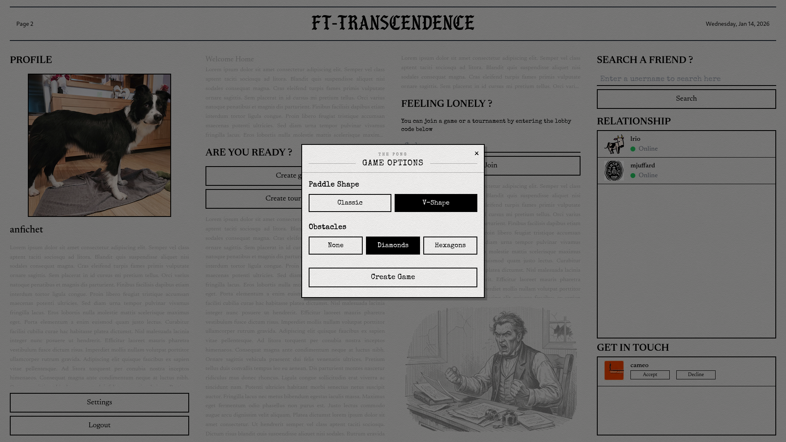
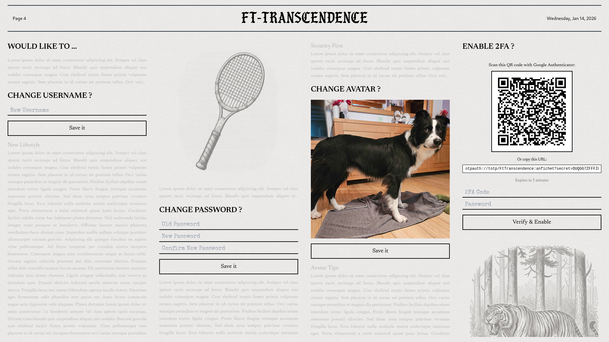
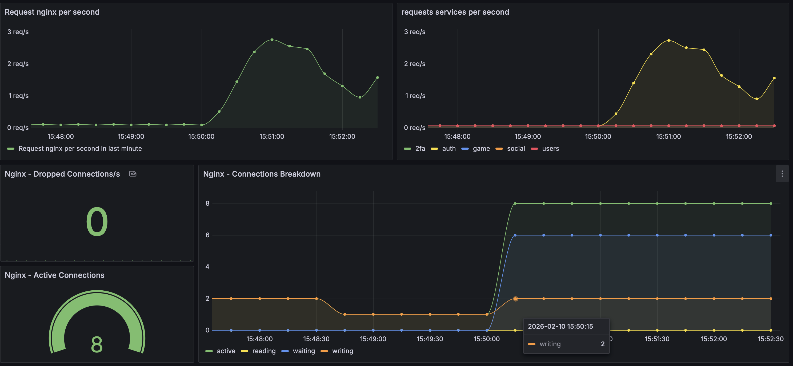

# ft_transcendence

**A full-stack, real-time multiplayer Pong platform — 42 School final project**

---

## 🎮 Overview

A complete multiplayer gaming platform with real-time gameplay, user authentication, social features, and a monitoring stack. Built as a microservices architecture that's easy to deploy and scale.

### Features

- **Real-time Pong** — multiplayer game with WebSocket-powered live gameplay
- **Tournaments** — bracket-style tournament system with matchmaking lobby
- **User profiles** — custom avatars, match history, stats
- **Social system** — friend requests, online/offline presence, real-time notifications
- **Secure authentication** — JWT sessions, Google OAuth, two-factor authentication
- **Monitoring stack** — Prometheus + Grafana dashboards + AlertManager with Discord alerts

### Key Capabilities

Play matches in real-time against other users, manage your social connections, track your stats, and see everything that's happening on the system through the monitoring dashboard. Account security is handled with modern authentication standards including 2FA. The whole thing runs in Docker, so you can spin it up anywhere.

---

## 📸 Screenshots

### Login & Authentication

### Home Dashboard

### Live Gameplay

### Game Settings

### User Profile

### Settings Panel

### Monitoring Dashboard

---

## 📚 Additional Documentation

- [Getting Started Guide](./docs/getting_started.md)
- [Complete Architecture](./docs/architecture.md)
- [Internal API](./docs/internal_api.md)
- [Monitoring Setup](./docs/monitoring.md)
- [Example .env Configuration](./.env.example)
