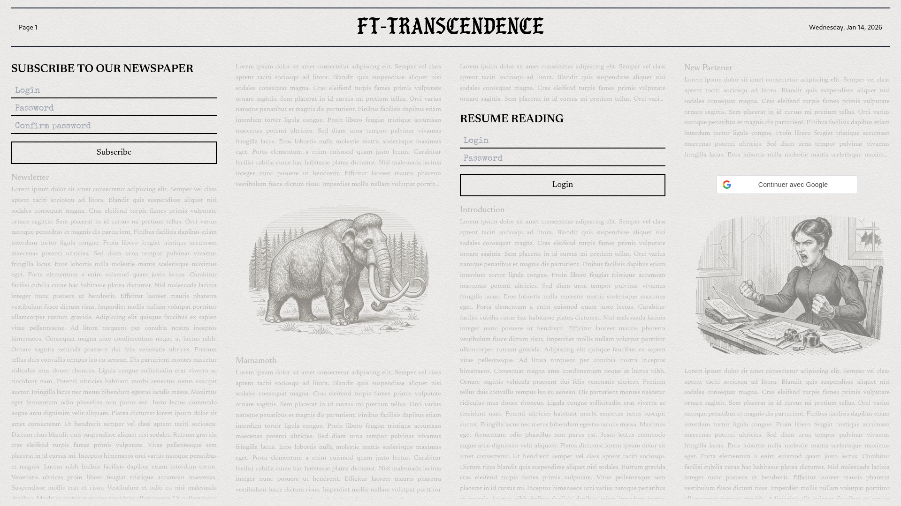
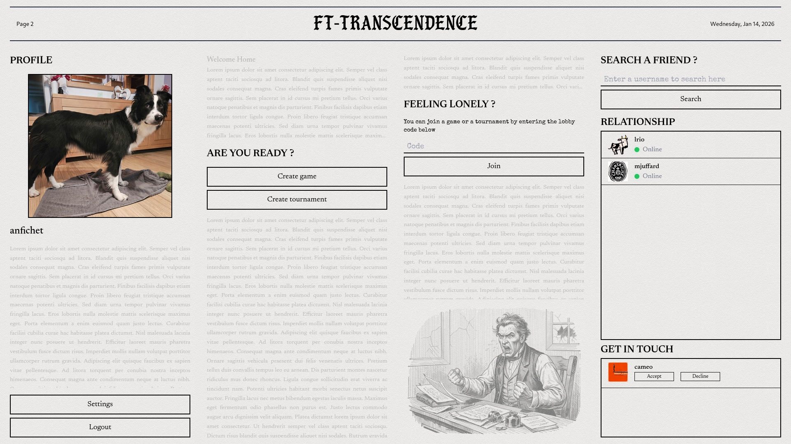
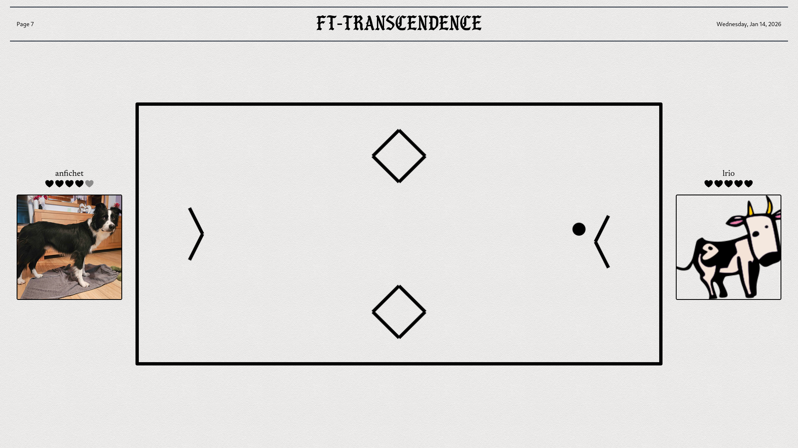
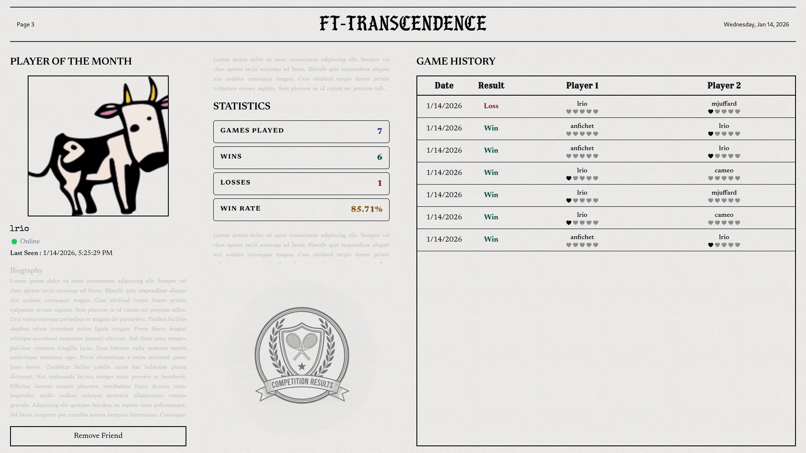

<div align="center">

# 🏓 ft_transcendence

**A full-stack, real-time multiplayer Pong platform — 42 School final project**

[](https://www.typescriptlang.org/)
[](https://fastify.dev/)
[](https://vite.dev/)
[](https://tailwindcss.com/)
[](https://docs.docker.com/compose/)
[](https://github.com/WiseLibs/better-sqlite3)

</div>

---

## 📸 Screenshots

<!-- Replace the paths below with your actual screenshots once added to docs/screenshots/ -->
<!-- See docs/screenshots/README.md for the suggested filenames -->

| Login | Home |
|:-----:|:----:|
|  |  |

| Pong Game | Lobby |
|:---------:|:-----:|
|  |  |

| Tournament | Profile |
|:----------:|:-------:|
|  |  |

---

## ✨ Features

- 🎮 **Real-time Pong** — multiplayer game with WebSocket-powered live gameplay
- 🏆 **Tournaments** — bracket-style tournament system with matchmaking lobby
- 👤 **User profiles** — custom avatars, match history, stats
- 👥 **Social system** — friend requests, online/offline presence, real-time notifications
- 🔐 **Secure authentication** — JWT sessions, Google OAuth, two-factor authentication (TOTP)
- 📊 **Monitoring stack** — Prometheus + Grafana dashboards + AlertManager with Discord alerts
- 🐳 **Fully containerised** — one-command startup via Docker Compose

---

## 🏗️ Architecture

The application is built as a collection of independent microservices, each with its own SQLite database, all fronted by an NGINX reverse proxy.

```
Client Browser
      │
   NGINX (TLS)
      ├── Frontend  (Vite SPA)
      ├── Auth      (JWT + Google OAuth)
      ├── Users     (profiles & avatars)
      ├── 2FA       (TOTP)
      ├── Social    (friends + WebSocket)
      └── Game      (Pong + WebSocket)
```

> See [docs/architecture.md](./docs/architecture.md) for the full Mermaid diagrams and service dependency graph.

---

## 🛠️ Tech Stack

| Layer          | Technology                                     |
| -------------- | ---------------------------------------------- |
| Frontend       | Vite · TypeScript · TailwindCSS (vanilla SPA)  |
| Backend        | Node.js · Fastify · TypeScript                 |
| Database       | SQLite via better-sqlite3 (one DB per service) |
| Real-time      | WebSockets (`ws`)                              |
| Auth           | JWT · TOTP (2FA) · Google OAuth                |
| Monitoring     | Prometheus · Grafana · AlertManager            |
| Infrastructure | Docker Compose · NGINX                         |
| Testing        | Jest · ts-jest                                 |

---

## 🚀 Quick Start

### Prerequisites

- Docker & Docker Compose
- Copy and fill in the environment file:

```bash
cp .env.example .env
# edit .env with your values
```

### Run

```bash
# Build and start all services
make build
make up
```

The app is available at `https://localhost:<PORT>` (port defined in `.env`).

### Other useful commands

```bash
make dev-build && make dev-up   # development mode with hot-reload
make test                        # run all tests
make format                      # format code (Prettier)
make down                        # stop all services
make reset-db                    # ⚠️  wipe all data volumes
```

> See [docs/getting_started.md](./docs/getting_started.md) for the full command reference.

---

## 📚 Documentation

| Document | Description |
| -------- | ----------- |
| [Architecture](./docs/architecture.md) | Microservices diagram, auth flow, communication patterns |
| [Getting Started](./docs/getting_started.md) | Setup, build & dev commands |
| [Internal API](./docs/internal_api.md) | Service-to-service API reference |
| [Monitoring](./docs/monitoring.md) | Prometheus / Grafana / AlertManager setup |
| [.env example](./.env.example) | All required environment variables |
